<h1 align="left">
  Hi, I'm Justin.
  
</h1>

  Working across different projects, keeping things practical, simple, and user-focused.

<table width="100%">
  <tr>
    <td valign="top" width="60%">

  

 

    My work so far has centered around desktop tools, projects, and documentation — work that often starts as "I need this" and turns into "maybe others will too."
  

  
  

    Alongside development, I work on related projects and maintain an archive of published work, focusing on keeping everything practical, clear, and consistently improving.
  

  

    
  

</td>

<td width="14" align="center" valign="middle">
  
    ·  
    · 
    ·  
    · 
    ·  
    ·
  
</td>

<td valign="top" width="40%">
  

    
  

  

    •
    <a href="https://www.justagwas.com">www.justagwas.com</a>
    &nbsp;•&nbsp;
    <a href="mailto:email@justagwas.com">email@justagwas.com</a>
    •
  

</td>
  </tr>
</table>
